<!-- Perfil de Lucas Viana Costa · cartões em assets/ gerados pela skill perfil-github -->

 

  

**Cofundador da AGI Nanotech, startup deeptech comprometida com o desenvolvimento sustentável. Doutorando em modelagem de polímeros no LMDOE/UFRJ.**

Sensores autônomos e inteligentes · química computacional

 

<picture>
  <source media="(max-width: 700px)" srcset="assets/papeis-celular.svg" />
  
</picture>

 

 

## 🚀 Projetos

<picture>
  <source media="(max-width: 700px)" srcset="assets/cases-celular.svg" />
  
</picture>

<b>📖 O que é cada projeto</b>

 

**🧬 ALMA** · pesquisa acadêmica · LMDOE/UFRJ
- **Problema:** descobrir materiais novos por tentativa e erro é lento e caro.
- **Solução:** ALMA (Ambiente Laboratorial de Materiais e Análises), a suíte computacional do LMDOE, organiza os dados do laboratório com proveniência. Com o PolyCalc, vai do SMILES aos oligômeros, a cálculos de química quântica (xTB e DFT) em clusters HPC e a datasets para modelos de machine learning.
- **Meu papel:** construí o PolyCalc, módulo de modelagem computacional da suíte ALMA.

**☀️ Tecnologia base** · pesquisa acadêmica
- **Problema:** sensores conectados precisam de energia para operar com autonomia.
- **Solução:** painéis fotovoltaicos orgânicos (OPV), de plástico, combinados com sensores IoT, em sistemas pensados para ter baixo custo.

**🌱 [ai-PLANTA](https://agi-nanotech.com/ai/planta)** · AGI Nanotech
- **Problema:** falta de água, de luz ou de adubo pode passar despercebida até a planta mostrar sintomas.
- **Solução:** sensor no vaso que mede a terra, a luz e o ar e avisa no celular. Em desenvolvimento, com lançamento previsto para 2027.

**💧 ai-AGUAS** · AGI Nanotech
- **Problema:** acompanhar parâmetros de qualidade da água.
- **Solução:** sensores baseados em nanopartículas plasmônicas e fotônicas.

Fontes: ai-PLANTA: agi-nanotech.com, consultado em 25/11/2026. Tecnologia base, ai-AGUAS e ALMA/PolyCalc: informação do autor, 26/11/2026.

 

## 🛠️ Stack

 
 

 

## 📫 Vamos conversar

**Vamos conversar sobre ciência e tecnologia?**

 

<table align="center"><tr><td align="center"><b>🔬 LVC Nanotech</b>   </td><td align="center"><b>🤖 AGI Nanotech</b>   </td></tr></table>

